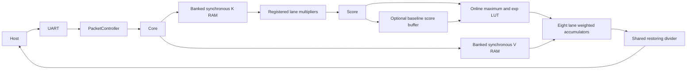
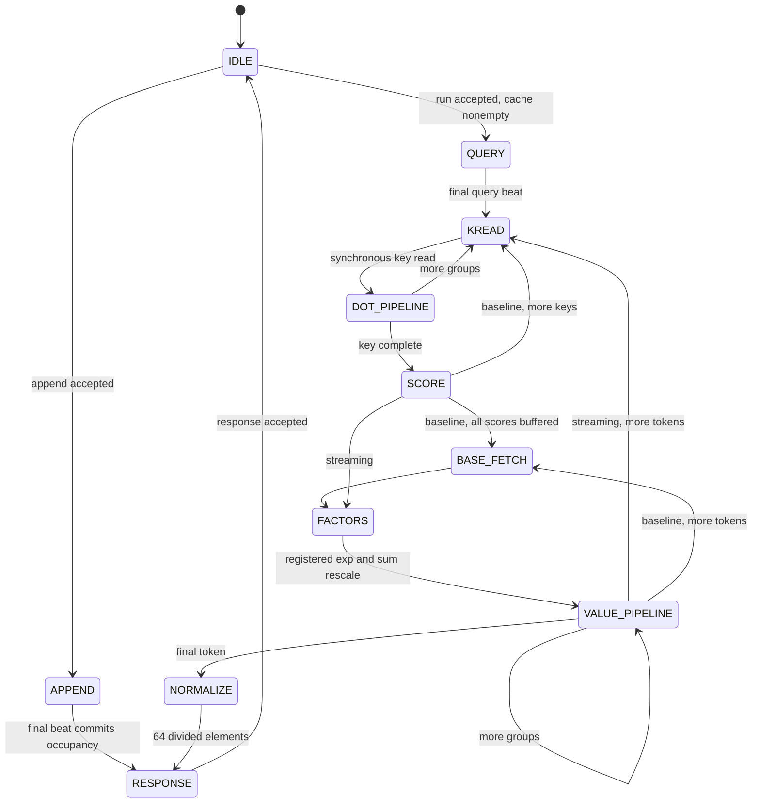

# Architecture and implementation milestones

1. Freeze numerical contract and model. 2. Implement banked cache and core.
3. Verify both architectures against generated vectors. 4. Add framed UART.
5. Run implementation in Vivado; inspect inferred RAM/DSP and timing.
6. Program board and collect measured results.

Cache bank = dimension % LANES; address = token*(64/LANES)+dimension/LANES.
Each bank has independent K and V synchronous read ports. Appending transfers
one LANES-byte beat for each group; occupancy commits only after the final
beat. Reset invalidates metadata, without clearing BRAM. Cache overflow
rejects append before any write. Single command outstanding; ready is low
through computation and while a response is pending. Input and response
payloads must remain stable under backpressure. Reset aborts partial append
and computation. The board packet controller receives a complete verified
frame before mutating the core.

Core commands: 0 reset, 1 append, 2 streaming run, 3 status, 4 baseline run.
Command valid/ready accepts opcode; subsequent input beats use data valid/ready
and packed little-endian INT8 lanes. Each append beat carries LANES key bytes
and the corresponding LANES value bytes together on separate k_data/v_data
signals. The UART frame instead contains all 64 K bytes followed by all 64 V
bytes; the packet controller converts that frame into paired core beats.
A query consumes 64/LANES beats on k_data; v_data is ignored for queries.
Response valid/ready returns error and an entire packed 64-byte vector.
Counters exclude query upload, host transfer and response stalls. The final
query beat initializes the accumulators and clears the counters; cycles then
counts from the first KREAD cycle through completion of the final division.
Memory reads count actual issued bank-wide
K or V reads. Multiply issue cycles count dot operand groups.

FSM: IDLE -> APPEND or QUERY -> key read/wait -> multiply/reduce -> score ->
softmax differences -> registered exponentials -> normalization multiply/commit ->
value read/wait -> weighted multiply/round/commit -> next token ->
divide each output -> RESPONSE. Baseline collects all scores before value pass.
Weighted rescaling splits the old signed accumulator into a signed high part
and unsigned low 16 bits. Two independently registered products implement
`old*alpha/65536` exactly, followed by registered rounding and addition.
This avoids an unregistered multi-DSP cascade across a complete rescale.
Maximum selection, LUT lookup and normalization multiplication occupy distinct
cycles; every level of the balanced dot reduction tree is registered. The
scheduler drains these levels before committing each dot group, including
after reset. This implementation prioritizes simple dependency control over
continuous dot-product issue.

The first version deliberately serializes these stages to preserve recurrence
dependencies. It makes no claim of overlapping tokens or peak MAC throughput.

Each K bank and V bank stores 4,096 bytes in the default configuration:

| Bank | First token dimensions | Addresses |
|---:|---|---|
| 0 | 0,8,16,24,32,40,48,56 | 0..7 |
| 1 | 1,9,17,25,33,41,49,57 | 0..7 |
| ... | ... | ... |
| 7 | 7,15,23,31,39,47,55,63 | 0..7 |

The second token uses addresses 8..15 in every bank. Logical storage is
16 banks * 4,096 bytes = 64 KiB; physical block allocation includes parity
and granularity overhead. Actual mapping is recorded in Vivado reports.
